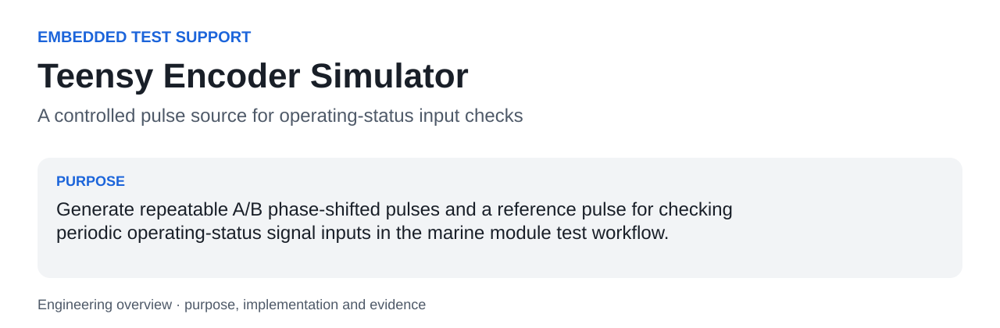
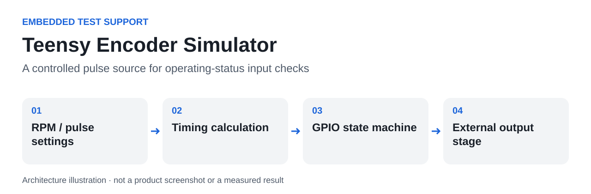

<a id="readme-top"></a>



# Teensy Encoder Simulator

**A controlled pulse source for operating-status input checks.**

Generate repeatable A/B phase-shifted pulses and a reference pulse for checking periodic operating-status signal inputs in the marine module test workflow.

| At a glance | |
|---|---|
| Context | Embedded Test Support |
| Current evidence | Source inspected; physical waveform and board target not verified here |
| Stack | Arduino C++, Teensy, GPIO scheduling, external N-MOSFET switching |
| Author | [hupositoc](https://github.com/hupositoc) |

[Case study](docs/case-study.md) · [Architecture](docs/architecture.md) · [Validation](docs/validation.md) · [Design rationale](docs/design-rationale.md)

## Table of Contents

- [About The Project](#about-the-project)
- [Getting Started](#getting-started)
- [Usage](#usage)
- [Roadmap](#roadmap)
- [Contributing](#contributing)
- [License](#license)
- [Contact](#contact)
- [Acknowledgments](#acknowledgments)

## About The Project

### Why I built it

The author used Teensy-related signal tooling for normal-operation signal checks during marine Type Approval activities. The code is a bench support sketch, not a class-approved signal generator.

A signal-analysis workflow needs a known input to distinguish a problem in the device, the wiring or the interpretation. A small configurable pulse source makes it possible to exercise the measurement path without depending on a mechanical sensor for every check.

### What I implemented

Derive revolution and pulse timing from RPM and pulses per revolution. Generate two outputs separated by a quarter period and a periodic REF output. Account explicitly for the inverted GPIO logic of an external N-MOSFET low-side switching stage.

### What this made possible

- Provide nominal A/B/reference behavior for bench checks of the signal path.
- Change RPM and pulse count in a small, inspectable sketch.
- Explain output timing and electrical inversion alongside the software logic.

### What happened in practice

The source provides the pulse-generation configuration used as test support. The author associates this tool family with normal-operation checks. Oscilloscope traces, timing uncertainty and a board-specific build result are not available in this public package.

### Built With

Arduino C++, Teensy, GPIO scheduling, external N-MOSFET switching. Dependencies provide integration capabilities; the source links below identify the project-specific behavior.

### Engineering decisions

### Calculate timing from a small parameter set

At 60 RPM, one revolution is 1 s; 212 pulses imply about 4.717 ms per pulse. The sketch uses integer microseconds, so nominal arithmetic is not a timing calibration.

### Make inversion explicit

GPIO HIGH turns the low-side MOSFET on, which pulls the external output low. Naming the desired output level helps avoid an inverted test signal.

### Separate software from electrical validation

A sketch cannot establish voltage range, isolation or signal integrity. Those require the actual circuit and measured waveforms.

### Code to inspect

| Source entry point | Responsibility |
|---|---|
| [`RPM`](encoder_simulator/encoder_simulator.ino#L20) | Nominal 60 revolutions per minute. |
| [`PULSES_PER_REV`](encoder_simulator/encoder_simulator.ino#L21) | Nominal 212 pulses per revolution. |
| [`B_OFFSET_US`](encoder_simulator/encoder_simulator.ino#L34) | Quarter-period offset for B relative to A. |
| [`writeOutput`](encoder_simulator/encoder_simulator.ino#L48) | Maps desired external level to inverted GPIO logic. |
| [`loop`](encoder_simulator/encoder_simulator.ino#L68) | Schedules pulse states from elapsed microseconds. |

### AI-assisted engineering

I use AI development tools to turn concrete needs into working software. My engineering responsibilities include defining the problem, interpreting the operating constraints, reviewing behavior, investigating failures and checking results. AI assistance is a development method; it is not evidence that a feature works. File-by-file AI authorship or a specific assistant/model is not claimed without the corresponding development record.

## Getting Started

### Prerequisites

The appropriate Teensy board package, Arduino-compatible tooling, the actual board, and the reviewed external output circuit.

### Installation

```text
git clone https://github.com/hupositoc/teensy-encoder-simulator.git
cd teensy-encoder-simulator
```

Then follow the project-specific path:

```text
Open encoder_simulator/encoder_simulator.ino in Arduino IDE.
Select the actual Teensy board and review the pin/circuit mapping before upload.
```

The commands describe the intended setup. See the validation record for which parts were actually executed in the current environment.

## Usage



**Text equivalent:** RPM / pulse settings → Timing calculation → GPIO state machine → External output stage.

Start by defining the intended input and expected behavior. Save the configuration with the experiment or test session so that an output can be interpreted later. Review exceptions and raw evidence before treating a summary as a final conclusion.

Parameter calculations and logic inversion were inspected from source. Board compilation, electrical levels and oscilloscope timing measurements have not been reproduced.

### Boundaries and known limitations

- The exact Teensy board model is not specified in the archived sketch.
- Nominal values are not measured frequency, jitter or phase-accuracy results.
- The 12 V external-output concept requires the intended interface circuit; never connect 12 V directly to a Teensy GPIO.

Read the [case study](docs/case-study.md) for the purpose and enabled workflow, and [architecture](docs/architecture.md) for the source-level explanation. The [validation document](docs/validation.md) separates verified checks, author-reported use and pending integration work.

## Roadmap

- [ ] Identify and pin the original board target.
- [ ] Publish a neutral schematic with component ratings and pin mapping.
- [ ] Measure frequency, duty cycle, A/B phase and REF width against the nominal settings.

These are planned tasks, not completed capabilities.

## Contributing

Use an issue to describe a reproducible problem, expected behavior, actual behavior and the environment. For a change, keep the scope focused and attach the relevant test or recording. Do not submit private customer data, identifying test captures, credentials or confidential certification documents.

## License

Existing file-level notices and third-party licenses remain in force. A repository-wide open-source license has not been selected for all archived material. Public visibility does not grant rights beyond those existing terms. Documentation structure attribution does not relicense the software.

## Contact

[hupositoc on GitHub](https://github.com/hupositoc) · [Project issues](https://github.com/hupositoc/teensy-encoder-simulator/issues)

## Acknowledgments

The top-level section order follows [Best-README-Template](https://github.com/othneildrew/Best-README-Template), reviewed under its [Unlicense](https://github.com/othneildrew/Best-README-Template/blob/main/LICENSE.txt). All project narratives are written for this implementation. Visual guidance is attributed in [design rationale](docs/design-rationale.md). The broader 50-repository documentation review informs the reading order, source links and evidence presentation; it does not imply endorsement by those projects.


[Engineering decision record](docs/engineering-decisions.md) · [Review of 50 reference repositories](docs/reference-review-50.md)
